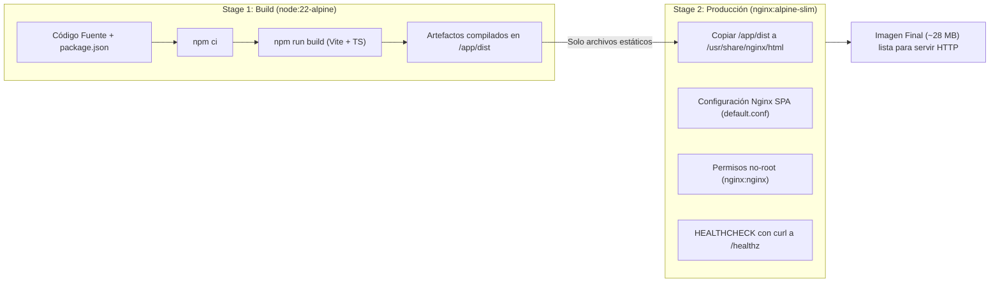

# Guía Integral de Despliegue con Docker y Nginx para Producción
## Portal Web TCU-102A UTN Guanacaste

Esta guía documenta la arquitectura de contenedores, la configuración del servidor web Nginx y los procedimientos paso a paso para desplegar la aplicación en servidores Linux (Ubuntu, Debian, AlmaLinux, RHEL, etc.), máquinas virtuales o nubes (AWS EC2, DigitalOcean, Hetzner, GCP, Azure).

---

## 1. Arquitectura de Contenedorización

La aplicación utiliza un patrón **Multi-Stage Dockerfile** optimizado para máxima velocidad de entrega, huella reducida y blindaje de seguridad:



### Ventajas clave:
* **Cero dependencias de Node.js en ejecución**: Node.js, `node_modules` y compiladores se descartan al finalizar el build.
* **Huella ultraligera**: Tamaño final inferior a 30 MB (vs 800+ MB si se mantuviera Node.js).
* **Rendimiento Nginx nativo**: Manejo eficiente de compresión Gzip, eventos asíncronos y caché HTTP.
* **Seguridad OWASP**: Cabeceras de seguridad inyectadas en cada respuesta (CSP, X-Frame-Options, X-Content-Type-Options, etc.).

---

## 2. Requisitos Previos del Servidor

* **Sistema Operativo**: Linux (Ubuntu 22.04/24.04 LTS recomendado) o Windows Server.
* **Docker Engine**: Versión 24.0 o superior ([Instrucciones oficiales](https://docs.docker.com/engine/install/)).
* **Docker Compose**: Plugin v2 (`docker compose version`).
* **Puertos del Host**:
  * Puerto de la aplicación: `8080` (personalizable en `.env`).
  * Puertos públicos estándar: `80` (HTTP) y `443` (HTTPS) para el Reverse Proxy.

---

## 3. Inicio Rápido (1 solo comando)

### Opción A: Mediante Scripts Automatizados

**En servidores Linux / macOS:**
```bash
chmod +x deploy.sh
./deploy.sh
```

**Para desplegar en modo producción blindada:**
```bash
./deploy.sh --prod
```

**En Windows (PowerShell):**
```powershell
.\deploy.ps1
# o para producción:
.\deploy.ps1 -Prod
```

---

### Opción B: Comandos Directos de Docker Compose

1. **Clonar o transferir el repositorio al servidor:**
   ```bash
   git clone https://github.com/tu-organizacion/TCU-UTN-WEB-react.git
   cd TCU-UTN-WEB-react
   ```

2. **(Opcional) Configurar variables de entorno:**
   ```bash
   cp .env.example .env
   # Editar con nano .env si deseas cambiar el puerto HOST_PORT
   ```

3. **Construir y levantar el contenedor:**
   ```bash
   # Despliegue estándar:
   docker compose up -d --build

   # O despliegue endurecido de producción:
   docker compose -f docker-compose.prod.yml up -d --build
   ```

4. **Verificar el estado del servicio:**
   ```bash
   docker compose ps
   # Probar el endpoint de salud
   curl http://localhost:8080/healthz
   ```

---

## 4. Configuración del Servidor Web Nginx

El archivo `nginx/default.conf` resuelve todos los retos típicos de las Single Page Applications (SPA):

### A. Enrutamiento SPA (React Router v7)
Evita el clásico error `404 Not Found` cuando los usuarios recargan rutas como `/cartografia`, `/sigaru` o `/normativa`:
```nginx
location / {
    try_files $uri $uri/ /index.html;
}
```

### B. Estrategia de Caché de Alto Impacto
* **`index.html` (NUNCA cacheado)**:
  Garantiza que cualquier nuevo despliegue sea visible al instante para todos los visitantes sin necesidad de borrar caché.
  ```nginx
  location = /index.html {
      add_header Cache-Control "no-store, no-cache, must-revalidate, proxy-revalidate, max-age=0" always;
  }
  ```
* **`/assets/*` (Caché Inmutable de 1 Año)**:
  Vite genera nombres de archivo con hash criptográfico (ej: `index-FMKITPid.js`). Si el contenido cambia, el hash cambia. Por ende, los activos se pueden almacenar en caché durante un año con seguridad absoluta:
  ```nginx
  location /assets/ {
      expires 1y;
      add_header Cache-Control "public, max-age=31536000, immutable";
  }
  ```

### C. Endpoint de Verificación de Salud (/healthz)
Permite a balanceadores de carga, monitores de uptime y al propio Docker verificar el estado del proceso en milisegundos sin registrar ruido en los logs:
```nginx
location = /healthz {
    access_log off;
    default_type text/plain;
    return 200 "healthy\n";
}
```

---

## 5. Configuración de Reverse Proxy y Certificados SSL (HTTPS)

Para exponer el portal web en producción en un dominio público (ej: `tcu.utn.ac.cr`), se recomienda colocar un Reverse Proxy al frente. A continuación se presentan las configuraciones recomendadas:

### Opción 1: Nginx en el Servidor Anfitrión (Host) + Let's Encrypt

1. **Instalar Nginx y Certbot en Ubuntu:**
   ```bash
   sudo apt update
   sudo apt install -y nginx certbot python3-certbot-nginx
   ```

2. **Crear el Virtual Host en `/etc/nginx/sites-available/tcu-utn.conf`:**
   ```nginx
   server {
       server_name tcu.utn.ac.cr www.tcu.utn.ac.cr;

       location / {
           proxy_pass http://127.0.0.1:8080;
           proxy_set_header Host $host;
           proxy_set_header X-Real-IP $remote_addr;
           proxy_set_header X-Forwarded-For $proxy_add_x_forwarded_for;
           proxy_set_header X-Forwarded-Proto $scheme;

           # Soporte para WebSockets y Keep-Alive
           proxy_http_version 1.1;
           proxy_set_header Upgrade $http_upgrade;
           proxy_set_header Connection "upgrade";
       }
   }
   ```

3. **Habilitar el sitio y emitir el certificado SSL gratuito:**
   ```bash
   sudo ln -s /etc/nginx/sites-available/tcu-utn.conf /etc/nginx/sites-enabled/
   sudo nginx -t && sudo systemctl reload nginx
   sudo certbot --nginx -d tcu.utn.ac.cr -d www.tcu.utn.ac.cr
   ```

---

### Opción 2: Nginx Proxy Manager (Interfaz Gráfica)

Si tienes un servidor con **Nginx Proxy Manager (NPM)**:
1. Entra al panel de NPM (`http://ip-servidor:81`).
2. Ve a **Hosts** > **Proxy Hosts** > **Add Proxy Host**.
3. Configura:
   * **Domain Names**: `tcu.utn.ac.cr`
   * **Scheme**: `http`
   * **Forward Hostname / IP**: `tcu-utn-web` (si comparten red Docker) o la IP privada del host.
   * **Forward Port**: `80` (en red Docker) o `8080` (en el host).
   * Activar: `Block Common Exploits` y `Websockets Support`.
4. En la pestaña **SSL**:
   * Selecciona `Request a new SSL Certificate`.
   * Activar: `Force SSL`, `HTTP/2 Support` y `HSTS Enabled`.
5. Guardar. ¡Listo!

---

### Opción 3: Caddy (SSL Automático sin configuración)

Caddy gestiona e instala certificados HTTPS automáticamente:

```caddy
tcu.utn.ac.cr {
    reverse_proxy 127.0.0.1:8080
}
```

---

### Opción 4: Cloudflare Tunnel (Cero Puertos Abiertos en el Firewall)

Si usas Cloudflare, puedes conectar el contenedor sin abrir el puerto 80 ni 443 en el router o firewall del campus universitario:
```bash
cloudflared tunnel route dns <tu-tunnel-name> tcu.utn.ac.cr
cloudflared tunnel run --url http://localhost:8080 <tu-tunnel-name>
```

---

## 6. Operaciones, Mantenimiento y Buenas Prácticas

### Ver Logs en Tiempo Real
Los contenedores tienen rotación de logs configurada para no saturar el disco (`max-size: 10m`, `max-file: 3`):
```bash
# Ver las últimas 100 líneas y seguir en vivo:
docker compose logs -f --tail=100

# O con el script:
./deploy.sh --logs
```

### Actualización sin Caída de Servicio (Zero-Downtime Deployment)
Cuando hagas cambios en el código o ejecutes `git pull`, actualiza el contenedor de la siguiente forma:

```bash
git pull origin main

# Reconstruye la nueva imagen antes de reiniciar el contenedor actual:
docker compose build --pull

# Recrea el contenedor en milisegundos con la nueva imagen:
docker compose up -d --no-deps tcu-utn-web
```
El tráfico entrante experimentará una transición transparente y el nuevo `index.html` servirá los nuevos bundles.

### Monitoreo de Consumo de Recursos
```bash
docker stats tcu-utn-web-prod
```
*Consumo típico en reposo: ~15 MB de RAM y < 0.1% CPU.*

### Detener el Servicio
```bash
./deploy.sh --down
# o manualmente:
docker compose down
```

---

## 7. Preguntas Frecuentes y Resolución de Problemas

| Síntoma | Causa Probable | Solución |
| :--- | :--- | :--- |
| **Error `404 Not Found` al refrescar `/cartografia`** | Nginx buscando archivo físico en vez de SPA | Asegurarse de que `try_files $uri $uri/ /index.html;` esté activo en Nginx (incluido en `nginx/default.conf`). |
| **Conflicto de Puerto `8080 already in use`** | Otro servicio está ocupando el puerto 8080 | Cambiar `PORT=8090` en el archivo `.env` o en el host. |
| **Estado `unhealthy` en el contenedor** | `curl` no logra alcanzar `http://localhost/healthz` | Ejecutar `docker exec -it tcu-utn-web curl -v http://localhost/healthz` para inspeccionar el código de respuesta. |
| **Cambios no visibles en navegador cliente** | Caché local agresivo de un navegador | El archivo `index.html` ya incluye cabeceras `no-cache`, pero si se cambió un recurso estático sin hash, forzar refresco con `Ctrl + Shift + R`. |
